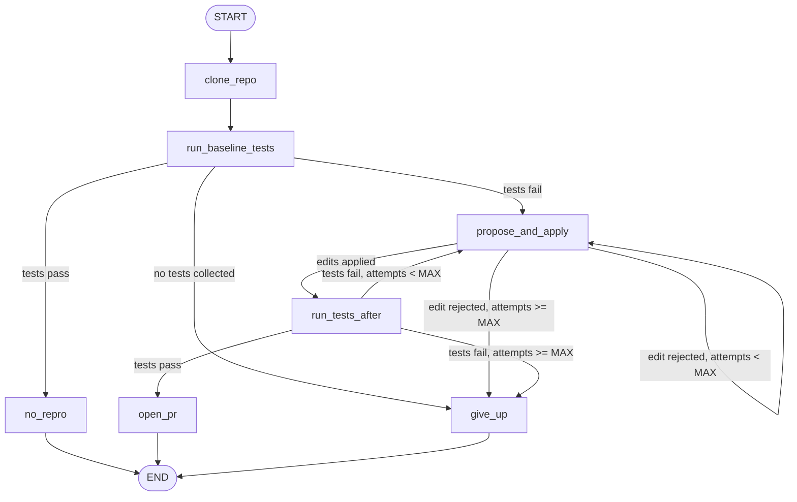

# AutoPatch

AutoPatch is a self-healing codebase agent. Give it a GitHub issue that describes a bug in a
Python repository and it clones the repo, reproduces the failure by running `pytest` in a
locked-down Docker sandbox, asks an LLM for a fix, applies it, and re-runs the tests. It
retries up to three times, feeding the new test log back to the model. If the tests pass it
pushes an `autopatch/*` branch and opens a pull request that explains the fix. If it cannot
fix the bug it stops with a clear `failed` status and a report.

**Demo video:** not recorded yet. The quickstart below reproduces the demo locally in about
a minute.

## Project status

Built and verified without API keys, so these things are still open:

| Area | State |
|---|---|
| Sandbox, edits, localization, graph loop, CLI, PR guard, eval harness | Tested: 148 tests pass on macOS, 13 of them against the real Docker sandbox |
| GitHub Actions CI, and Linux in general | **Not run yet.** The workflow file exists but has never executed |
| Real LLM call through OpenRouter | **Not run yet.** Needs `OPENROUTER_API_KEY`. Only mocked so far |
| Real pull request on GitHub | **Not run yet.** Needs `GITHUB_TOKEN`. Tested against a local bare repo and a fake API client |
| Eval numbers | **Not run yet.** `autopatch eval` fills in the table below |

## How it works



| Node | What it does |
|---|---|
| `clone_repo` | Clones the GitHub repo, or copies a local path, into a temporary working copy |
| `run_baseline_tests` | Runs `pytest` in the sandbox to reproduce the failure |
| `propose_and_apply` | Resets the working copy, picks relevant files from the test log, asks the LLM for search-and-replace edits, validates and applies them |
| `run_tests_after` | Runs `pytest` again on the patched code |
| `open_pr` | Saves `fix.patch`; unless `--dry-run`, commits on `autopatch/issue-N-xxxxxx`, pushes, opens a PR |
| `give_up` | Status `failed`; saves the last diff that was tried |
| `no_repro` | The tests already pass, so there is nothing to fix |

The flow is a [LangGraph](https://github.com/langchain-ai/langgraph) state graph
(`src/autopatch/graph.py`). The model is called through the OpenAI SDK pointed at
OpenRouter, with `temperature=0`.

## Quickstart

Requirements: Python 3.11+, git, a running Docker daemon, an
[OpenRouter](https://openrouter.ai) API key. Install with `pip install -e .`, then:

```bash
cp .env.example .env        # then put your OPENROUTER_API_KEY in .env
autopatch build-sandbox
autopatch fix --repo /tmp/buggy --issue-file eval/bugs/02.md --dry-run
```

The third command needs a buggy repo. Create one from the eval set first:

```bash
cp -r eval/clean_repo /tmp/buggy && (cd /tmp/buggy && git apply "$OLDPWD/eval/bugs/02.patch")
```

A dry run never contacts GitHub. It prints each step, then writes into `runs/<run_id>/`:

| File | Content |
|---|---|
| `events.jsonl` | One JSON line per step: `{ts, node, summary, data}` |
| `report.md` | Issue, status, each attempt's reasoning, edits and test result, duration |
| `fix.patch` | The fix as a unified diff (when fixed) |
| `last_attempt.patch` | The last diff that was tried (when failed) |

### Opening a real pull request

Add a `GITHUB_TOKEN` to `.env`. It needs read access to issues and write access to contents
and pull requests of the target repo (classic token: the `repo` scope).

```bash
autopatch fix --repo https://github.com/OWNER/REPO --issue 12
```

### Commands

| Command | Purpose |
|---|---|
| `autopatch fix --repo <github_url> --issue <n>` | Real run: fix the issue and open a PR |
| `autopatch fix --repo <github_url> --issue <n> --dry-run` | Fetch the issue, fix locally, open no PR |
| `autopatch fix --repo <path> --issue-file issue.md --dry-run` | Local run. First line of the file is the title, the rest is the body |
| `autopatch eval` | Run the evaluation on the ten seeded bugs |
| `autopatch eval --check` | Only verify the eval set (no LLM calls) |
| `autopatch build-sandbox` | Build the sandbox image |

Exit code of `fix`: `0` fixed, `1` failed (or a usage or configuration error), `2` no_repro.

Settings are read from `.env` (see `.env.example`): model, sandbox image, timeout, memory
limit, `MAX_ATTEMPTS`, `MAX_CONTEXT_CHARS`.

### Run viewer (optional)

```bash
pip install -e ".[viewer]"
streamlit run src/autopatch/viewer.py
```

It reads `runs/*/events.jsonl` and shows the step timeline, the patch and the report.

## Safety design

- **No-network sandbox.** Repository code only ever runs inside a Docker container with
  `network_mode="none"`. Nothing from the target repo is executed on the host.
- **Read-only mount.** The working copy is mounted read-only, so tests cannot modify it.
- **Locked-down container.** All capabilities dropped, `no-new-privileges`, 1 CPU, memory
  and PID limits, a hard timeout, and it runs as your user id, not root.
- **Test files are protected.** Edits to `tests/`, `test_*.py`, `*_test.py`, `conftest.py`,
  anything under `.git/`, and any non-`.py` file are rejected. Paths that leave the repo
  (`..`, absolute paths, symlinks) are rejected. A second check refuses to commit a test
  file. The agent has to fix the source code; it cannot edit tests or pytest configuration.
- **All-or-nothing edits.** Every edit is validated first. If one is invalid, none is written.
- **PR only.** AutoPatch writes only to `autopatch/*` branches. A guard refuses the default
  branch, `main` and `master` before both the commit and the push, and the push names its
  one branch explicitly. Merging is always left to a human.
- **Retry cap.** At most `MAX_ATTEMPTS` (default 3) model calls per run.
- **Secrets.** Keys are read from `.env` only, which is git-ignored. The GitHub token is not
  left in the clone's git config, and it is removed from any error text before logging.

**Docker socket tradeoff.** `docker-compose.yml` mounts `/var/run/docker.sock` into the
AutoPatch container so it can start sandbox containers. Whoever controls that socket
controls the host's Docker daemon, which is equivalent to root on the host. The sandbox
containers themselves do not get the socket. Use compose only on a machine you trust, or
install AutoPatch with `pip` and run it directly.

```bash
docker compose run --rm autopatch build-sandbox
docker compose run --rm autopatch fix --repo https://github.com/OWNER/REPO --issue 12
```

## Evaluation

`eval/clean_repo/` is a small stdlib-only package (`toolkit`, ten modules) whose tests all
pass. `eval/bugs/` holds ten bugs, each as `NN.patch` (injects the bug) and `NN.md` (an
issue that describes the symptoms, without pointing at the line).

| Bug | Difficulty | Kind | Module |
|---|---|---|---|
| 01 | easy | off-by-one | `strings` |
| 02 | easy | wrong operator | `cart` |
| 03 | easy | `<` instead of `<=` | `inventory` |
| 04 | easy | swapped arguments | `mathutils` |
| 05 | medium | wrong default argument | `parser` |
| 06 | medium | mutable default argument | `inventory` |
| 07 | medium | missing edge case (empty stack) | `stack` |
| 08 | medium | wrong string formatting | `dates` |
| 09 | hard | bug spanning two functions | `cache` |
| 10 | hard | wrong algorithm (pager window) | `pagination` |

For each bug the eval copies the clean repo, commits it, applies the patch, and runs the
agent in dry-run mode with the issue text.

### Results

<!-- eval-results:start -->
Not run yet. The evaluation needs an `OPENROUTER_API_KEY`. Run `autopatch eval` and this
block is replaced with the results table and summary line (also saved to `eval/results.md`).
<!-- eval-results:end -->

To reproduce: `autopatch eval`. It makes at least ten model calls. For a subset use
`autopatch eval --only 01,02`.

## Limitations

- Python repositories with pytest tests only.
- The sandbox has no network, so target repos may only need the standard library plus
  pytest. Anything that needs `pip install` will fail at import time.
- Context selection is a heuristic: files named in the failing test log plus the modules
  the failing tests import, capped at `MAX_CONTEXT_CHARS`. A bug far from the traceback, or
  in a file over 20 KB, may never reach the model.
- pytest runs with `-x`, so the model sees one failing test at a time.
- Each retry starts again from the original code; the model sees its previous edits and
  the resulting log, but edits do not accumulate across attempts.
- "Fixed" means the existing test suite passes. A weak suite can accept a wrong fix, which
  is why the result is a pull request for a human to review.
- Edits can only change existing `.py` files. The agent cannot create or delete files.
- Single user, one run at a time.
- Tested on macOS with Docker Desktop only. Linux has not been run yet.

## Future work

- Dependency install phase: build a per-repo image with network access, then run the tests
  offline in it.
- More languages and test runners.
- Generate a regression test for the fix.
- Richer repository search (symbol index, embeddings) in place of the log heuristics.

## Development

```bash
pip install -e ".[dev]"
ruff check .
pytest -m "not docker"      # no Docker needed
autopatch build-sandbox
pytest -m docker            # sandbox and end-to-end tests; skipped if Docker is unavailable
```

No test calls a real LLM or GitHub. CI (`.github/workflows/ci.yml`) runs both groups.
Design choices and deviations from `SPEC.md` are recorded in `DECISIONS.md`.
